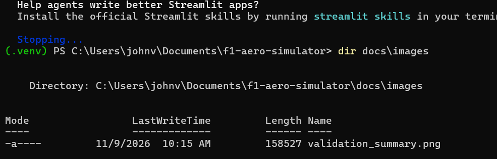
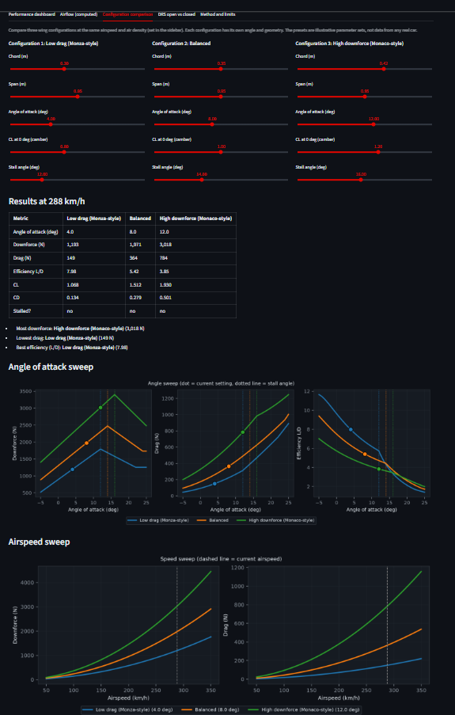
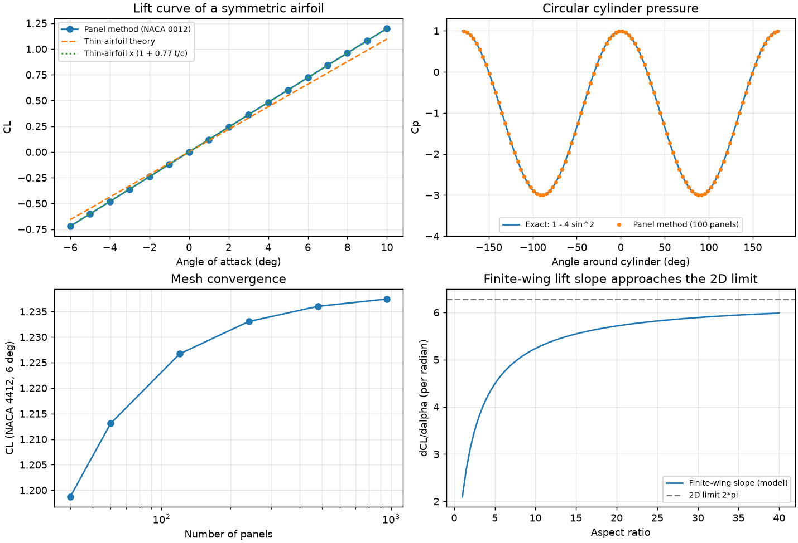

# F1 Aerodynamics Simulator

An interactive Python simulator that shows how an F1-style wing makes downforce and drag, and how changing the angle, geometry and airspeed changes both. It combines a fast analytical wing model with a 2D panel-method flow solver, and it is explicit about what each one can and cannot do.

> **Honest scope:** this is an engineering-education and portfolio project. It is **not CFD**, and its presets are illustrative parameter sets, not data from any real car. See [Limitations](#limitations).


## What it does

- **Performance dashboard:** downforce and drag in newtons, CL, CD, L/D, dynamic pressure, induced-drag share and the power drag absorbs, updating live as you move the sliders.
- **Computed airflow:** a 2D Hess-Smith panel method solves potential flow around a NACA 4-digit airfoil section and draws the pressure-coefficient map, streamlines and surface Cp distribution. The wing is drawn inverted, as on an F1 car.
- **Configuration comparison:** three wing setups side by side, with angle-of-attack sweeps (downforce, drag, efficiency) and airspeed sweeps.
- **DRS open vs closed:** compares the wing with the rear-wing flap open and closed, using an illustrative flattening model (not calibrated to any real car).
- **Method and limits tab:** states the models, validation and limitations inside the app.

| Airflow (computed) | Configuration comparison |
|---|---|
|  |  |

## Quick start

Requires Python 3.10 or newer.

**Windows (PowerShell)**

```powershell
git clone https://github.com/JxhnBeloved/f1-aero-simulator.git
cd f1-aero-simulator
python -m venv .venv
.venv\Scripts\Activate.ps1
pip install -r requirements.txt
streamlit run app.py
```

**macOS / Linux**

```bash
git clone https://github.com/JxhnBeloved/f1-aero-simulator.git
cd f1-aero-simulator
python3 -m venv .venv
source .venv/bin/activate
pip install -r requirements.txt
streamlit run app.py
```

Run the tests and the validation report:

```bash
pytest -q
python scripts/run_validation.py
```

## How it works

Two models, kept separate on purpose:

| | Analytical wing model | 2D panel method |
|---|---|---|
| Used for | Forces in newtons, CL, CD, L/D, comparisons | Streamlines and surface pressure |
| Method | Prandtl lifting-line slope, induced drag, empirical stall | Hess-Smith source panels + vortex, Kutta condition |
| Dimension | Finite 3D wing | 2D airfoil section |
| Status | Engineering estimate | Computed numerical solution (inviscid) |

Key equations:

```text
q    = 0.5 * rho * V^2                      dynamic pressure
F    = q * S * C                            downforce (CL) and drag (CD)
a    = a0 / (1 + a0 / (pi * e * AR))        finite-wing lift slope, a0 = 2*pi
CDi  = CL^2 / (pi * e * AR)                 induced drag
Cp   = 1 - (V / Vinf)^2                     pressure coefficient (Bernoulli)
```

## Example results

Illustrative presets at 288 km/h, sea-level air (not real car data):

| Preset | Angle | Downforce | Drag | L/D |
|---|---|---|---|---|
| Low drag (Monza-style) | 4 deg | 1,193 N | 149 N | 7.98 |
| Balanced | 8 deg | 1,971 N | 364 N | 5.42 |
| High downforce (Monaco-style) | 12 deg | 3,018 N | 784 N | 3.85 |

The high-downforce setup makes about 2.5 times the downforce of the low-drag setup but pays about 5 times the drag. That trade-off is the core of F1 wing setup.

## Verification

- 59 automated tests (`pytest`), including invariants checked across 450 wing and flow configurations.
- 25 validation checks with an expected-vs-observed report: [docs/validation_report.md](docs/validation_report.md).
- The panel method reproduces the exact cylinder pressure distribution (max error 0.004), satisfies the Kutta condition, gives near-zero drag for a closed body, and converges as panels are added (0.5 % change from 120 to 240 panels).



Verification shows the code solves its equations correctly. It does **not** show agreement with a wind tunnel or a real car.

## Limitations

- The analytical stall behaviour is an empirical shape, not a boundary-layer calculation.
- The panel method is 2D and inviscid: no friction drag, no separation, no stall, no tip vortices.
- Not modelled: Reynolds-number effects, ground effect, multi-element wings, wheel and bodywork interaction, compressibility.
- Presets and default parameters are illustrative. Use the results to compare trends, not as absolute predictions.

Full discussion: [docs/engineering_report.md](docs/engineering_report.md).

## Project structure

```text
f1-aero-simulator/
  app.py                 Streamlit entry point (wiring only)
  aero/                  Physics: wing model, coefficients, forces, panel method, theory
  viz/                   Matplotlib figures and the shared colour theme
  ui/                    Streamlit interface: sidebar, tabs, styling
  tests/                 pytest suite
  scripts/               Validation report generator
  docs/                  Engineering report, validation report, images
  .streamlit/config.toml Dark theme
```

## Roadmap

- Multi-element rear wing (main plane + flap with slot)
- Ground effect and ride-height sensitivity
- Front wing vs rear wing comparison
- DRS open vs closed (done)
- Sensitivity analysis of the most influential parameters
- Optional OpenFOAM case for comparison with a real RANS solution

## Tech stack

Python, NumPy, Matplotlib, Streamlit, pytest.

## References

- J. Katz, *Race Car Aerodynamics: Designing for Speed*
- J. D. Anderson, *Fundamentals of Aerodynamics*
- J. Katz and A. Plotkin, *Low-Speed Aerodynamics*
- I. H. Abbott and A. E. von Doenhoff, *Theory of Wing Sections*
- J. L. Hess and A. M. O. Smith, "Calculation of potential flow about arbitrary bodies", *Progress in Aerospace Sciences*, 1967

## License

MIT. See [LICENSE](LICENSE).
