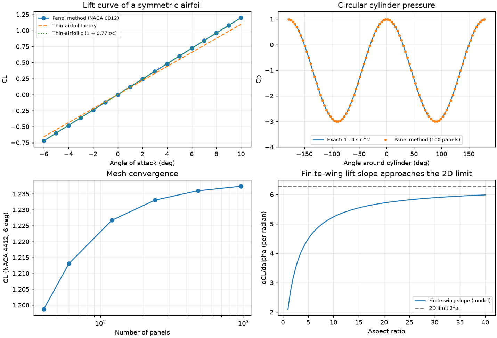

# Validation report

Generated 2026-11-09 with Python 3.14.7 and NumPy 2.5.4. Reproduce with `python scripts/run_validation.py`.

**Result: 25 of 25 checks passed.**

These checks compare the simulator against analytical results, exact solutions and its own invariants. They show the code solves its equations correctly. They do not show that the models match a real car or a wind tunnel.

## A. Analytical wing model

| ID | Check | Expected | Observed | Result |
|---|---|---|---|---|
| A1 | Dynamic pressure at 80 m/s, sea level | 3920 Pa | 3920.0 Pa | PASS |
| A2 | Doubling airspeed multiplies downforce and drag by 4 | 4.000 and 4.000 | 4.000 and 4.000 | PASS |
| A3 | Doubling air density doubles the forces | 2.000 | 2.000 | PASS |
| A4 | Geometric similarity: chord and span x2 gives forces x4, CL unchanged | x4.000, CL ratio 1.000 | x4.000, CL ratio 1.000 | PASS |
| A5 | Lift slope tends to the thin-airfoil value 2*pi as aspect ratio grows | ratio 1.000 | ratio 1.000000 | PASS |
| A6 | Induced drag = CL^2/(pi e AR) for CL = 1, AR = 2, e = 1 | 0.15915 | 0.15915 | PASS |
| A7 | CL is zero at the analytically derived zero-lift angle | 0.0 | 0.0e+00 at -15.61 deg | PASS |
| A8 | Downforce peaks at the stall angle | 14.00 deg | 14.00 deg | PASS |
| A9 | Efficiency L/D rises with span (aspect ratio 1.7 -> 2.7 -> 4.0) | increasing | 3.74 < 5.42 < 7.41 | PASS |
| A10 | Power absorbed by drag = D * V | 29.1 kW | 29.1 kW | PASS |

## B. 2D panel method

| ID | Check | Expected | Observed | Result |
|---|---|---|---|---|
| B1 | Circular cylinder: Cp = 1 - 4 sin^2(theta), max error | < 0.010 | 0.0039 | PASS |
| B2 | Symmetric NACA 0012 at 0 deg gives zero lift | abs(CL) < 0.001 | -4.6e-15 | PASS |
| B3 | Lift is odd in angle for a symmetric airfoil: CL(-5) = -CL(5) | -0.6023 | -0.6023 | PASS |
| B4 | NACA 0012 at 5 deg vs thin-airfoil theory with thickness correction | 0.599 (+/- 5 %) | 0.602 | PASS |
| B5 | NACA 4412 at 0 deg vs thin-airfoil theory with thickness correction | 0.498 (+/- 5 %) | 0.507 | PASS |
| B6 | Lift slope per degree (thin airfoil 0.110, thickness raises ~9 %) | 0.115 to 0.125 | 0.1200 | PASS |
| B7 | d'Alembert: zero drag for a closed body in inviscid flow | abs(CD) < 0.005 | 0.00032 | PASS |
| B8 | Kutta condition: trailing-edge speeds from both surfaces match | sum = 0 | 6.7e-16 | PASS |
| B9 | Lift from pressure integration vs Kutta-Joukowski (CL = 2 Gamma / V c) | 1.2417 (+/- 3 %) | 1.2267 | PASS |
| B10 | Mesh convergence: CL change from 120 to 240 panels | < 1 %, shrinking with refinement | 0.51 % | PASS |
| B11 | Field velocity just outside the surface equals surface velocity | 1.3828 (+/- 1 %) | 1.3828 | PASS |
| B12 | Cp distribution mirror symmetry for a symmetric airfoil | < 1e-9 | 3.4e-14 | PASS |

## C. Configuration matrix

| ID | Check | Expected | Observed | Result |
|---|---|---|---|---|
| C1 | 3 presets x 10 angles x 5 speeds x 3 densities = 450 configurations: finite, positive, stall flag consistent | 0 failures | 0 failures | PASS |
| C2 | Presets are ordered: low drag < balanced < high downforce in downforce and drag | both increasing | downforce True, drag True | PASS |
| C3 | The low-drag preset has the best L/D | low drag highest | 7.98, 5.42, 3.85 | PASS |

## Preset behaviour at 288 km/h

| Preset | AoA (deg) | Downforce (N) | Drag (N) | L/D |
|---|---|---|---|---|
| Low drag (Monza-style) | 4.0 | 1,193 | 149 | 7.98 |
| Balanced | 8.0 | 1,971 | 364 | 5.42 |
| High downforce (Monaco-style) | 12.0 | 3,018 | 784 | 3.85 |

## Known behaviours and limits

- **Negative CL:** if the angle is below the zero-lift angle (possible when the CL-at-0-deg parameter is small), the wing produces lift, and the simulator reports negative downforce and a negative L/D. This is the correct sign, not an error.
- **Zero airspeed:** forces are exactly zero; L/D is a ratio of coefficients and stays finite.
- **Stall:** the analytical model's stall is an empirical shape. The panel method has no boundary layer, so it cannot stall at all.
- **Mesh error:** at the default 120 panels the panel-method lift is within about 1 % of the converged value (check B10).
- **Not validated against experiment:** no wind-tunnel or on-track data was used.

## Figures

